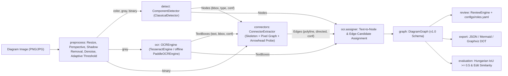

# ArchLens Architecture

ArchLens converts photos and scans of software architecture diagrams into validated `DiagramGraph` objects and deterministic design-review findings using an entirely local, modular computer vision pipeline.

## Pipeline Overview

## Module Responsibilities & Swappable Interfaces

| Module | Responsibility | Extension / Swap Point |
| --- | --- | --- |
| `archlens.preprocess` | Resizing, optional paper-quad perspective warp, illumination division, denoising, adaptive thresholding | `PreprocessConfig` in `configs/default.yaml` |
| `archlens.detect` | Component detection (`box`, `database`, `ellipse`, `component`) and nested duplicate filtering | `ComponentDetector` ABC (`detect(preprocessed) -> list[Node]`) |
| `archlens.ocr` | Local text recognition, configurable text normalization, and node/edge text assignment | `OCREngine` ABC (`read(image) -> list[TextBox]`) |
| `archlens.connectors` | Node/text masking, `skimage` skeletonization, pixel-graph tracing, snapping, arrowhead direction | `ConnectorExtractor` ABC (`extract(preprocessed, nodes, text_boxes) -> list[Edge]`) |
| `archlens.graph` | Canonical Pydantic contract (`Node`, `Edge`, `DiagramGraph`) and JSON I/O | Schema documented in [schema.md](schema.md) |
| `archlens.review` | Keyword role inference (`configs/roles.yaml`) and deterministic design rule evaluation | `ReviewRule` ABC (`evaluate(context) -> list[Finding]`) |
| `archlens.export` | Lossless JSON, Mermaid `flowchart LR`, and Graphviz DOT serialization | Pure functions over `DiagramGraph` |
| `archlens.evaluation` | Hungarian node matching (`IoU >= 0.5`), normalized label similarity, edge F1, latency & overlays | `evaluate_dataset(...)` and `scripts/evaluate.py` |

## Privacy & Offline Guarantees

- **No cloud AI APIs or VLMs** in the MVP runtime path.
- **No runtime network calls or telemetry**: Tesseract executes via local CLI, `PaddleOCREngine` requires pre-populated local `det/` and `rec/` directories (`DISABLE_MODEL_SOURCE_CHECK=True`, `PADDLEOCR_OFFLINE=1`), and the Streamlit UI runs locally.

